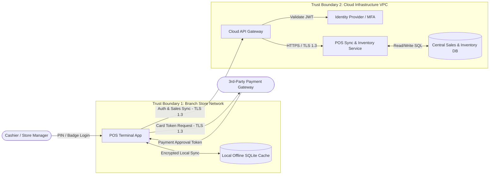

# Cybersecurity Threat Model & Risk Assessment: Multi-Branch Retail POS Cloud Sync System

## 1. Executive Summary
This repository contains an end-to-end **STRIDE Threat Model**, **Risk Assessment**, and **ITIL-Aligned Incident Response Playbook** for a distributed retail Point-of-Sale (POS) architecture. 

The system synchronizes real-time sales transactions, inventory updates, and user authentication across **25+ retail branches** and a centralized cloud backend. The objective of this assessment is to identify architectural vulnerabilities across trust boundaries, prioritize risks by business impact, and define actionable 2nd-line operational controls.

---

## 2. System Architecture Overview
The environment operates across three primary security zones:
1. **Branch Store Network (Untrusted / Edge Zone):** Contains POS terminals, barcode scanners, and a local edge sync service with offline caching for internet outages.
2. **Cloud Infrastructure (Trusted Application Zone):** Hosted in AWS/Azure, featuring an API Gateway, Identity Provider (IdP), Inventory & Sales Sync Microservice, and an encrypted Relational Database.
3. **External Third-Party Services (External Zone):** PCI-DSS compliant Payment Gateway handling card tokenization and authorization.

---

## 3. Data Flow Diagram (DFD) & Trust Boundaries
The diagram below illustrates how authentication, transaction, and inventory data move across **three distinct Trust Boundaries** (marked by dashed borders).

---

## 4. Repository Structure
* **[01_Asset_and_Trust_Boundary_Inventory.md](./01_Asset_and_Trust_Boundary_Inventory.md):** Critical data assets, user privilege matrix, and network zone definitions.
* **[02_STRIDE_Threat_Matrix.md](./02_STRIDE_Threat_Matrix.md):** Detailed analysis of 12 realistic threats scored using a Likelihood × Impact risk matrix.
* **[03_Incident_Response_and_ITIL_Playbook.md](./03_Incident_Response_and_ITIL_Playbook.md):** Preventative security controls paired with 2nd-line triage, containment, and escalation runbooks.
* **`/diagrams/`:** Source diagram files (`.drawio` / `.json`) and high-resolution `.png` exports.

---

## 5. Frameworks & Standards Referenced
* **STRIDE Threat Modeling Methodology** (Spoofing, Tampering, Repudiation, Information Disclosure, Denial of Service, Elevation of Privilege)
* **NIST Cybersecurity Framework (CSF 2.0)** (Identify, Protect, Detect, Respond, Recover)
* **ITIL v4 Incident Management** (Triage, Escalation, Containment, Root Cause Analysis)
* **PCI-DSS v4.0** (Scope reduction via point-to-point encryption and tokenization)
