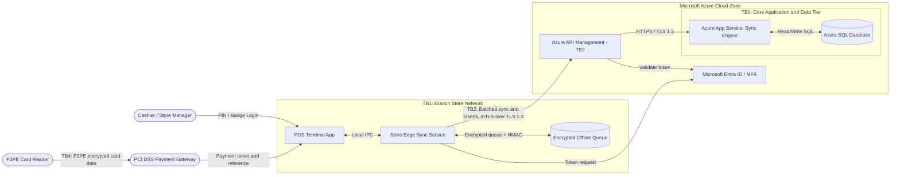

# Cybersecurity Threat Model & Risk Assessment: Multi-Branch Retail POS Cloud Sync System

## 1. Executive Summary

This repository presents a **STRIDE threat model, risk assessment, and ITIL-aligned incident response playbook** for a distributed retail Point-of-Sale (POS) cloud synchronization architecture.

The modeled system supports real-time sales transaction processing, inventory updates, and user authentication across **25+ retail branches** and a centralized cloud backend. It keeps trading during branch connectivity drops by queuing transactions offline. The assessment maps trust boundaries, identifies high-impact threats, assigns risk ratings, and defines preventative controls alongside 2nd-line operational triage and escalation steps.

> **Scope & Assessment Note:** This is a security architecture and operational risk assessment, not a compliance audit or PCI DSS assessment. It assumes a validated P2PE solution and a PCI DSS-validated payment gateway, and does not claim that the modeled POS environment is PCI DSS compliant. Gateway internals, card reader firmware, and physical facility security are out-of-scope dependencies.

## 2. Architecture and Trust Boundaries

Data flows between store terminals, local edge queues, Azure cloud services, and external payment endpoints across defined **trust boundaries**: the points where data moves from a lower-trust zone (such as a busy store network) into a higher-trust zone (such as the central cloud database).

| ID | Trust Boundary |
| :--- | :--- |
| **TB1** | Terminal / peripherals to store edge sync service |
| **TB2** | Store network to Azure (internet, through API Management) |
| **TB3** | API Management to App Service and Azure SQL |
| **TB4** | Card reader to external payment gateway (P2PE path) |

## 3. Key Findings

| # | Threat | STRIDE | Inherent Risk | Primary Controls |
| :--- | :--- | :--- | :--- | :--- |
| 1 | Tampering with queued offline transactions | Tampering | High | Encrypted queue, per-record HMAC, server-side validation on sync |
| 2 | Replay or duplicate transactions on resync | Tampering / Repudiation | High | Idempotency keys, sequence numbers, duplicate detection |
| 3 | Stolen or cloned terminal authenticating to the cloud | Spoofing | High | Device certificates (mTLS), Entra ID Conditional Access, remote revoke |
| 4 | Compromised terminal attempting to capture card data | Information Disclosure | High | P2PE at the card reader, tokens only, application allow-listing |
| 5 | Branch sync flood overwhelming the API | Denial of Service | Medium | APIM rate limiting, per-branch quotas, queue back-pressure |

*Inherent risk reflects pre-control exposure. Full scoring is in `02_STRIDE_Threat_Matrix.md`.*

## 4. System Architecture Overview

The architecture spans three primary security zones:

* **Branch Store Network (Edge / Lower-Trust Zone):** POS terminals, peripheral devices (barcode scanners, receipt printers), a local store edge sync service, and an encrypted offline transaction queue that stores sales locally during internet outages.
* **Cloud Backend (Application & Data Zone):** Hosted on **Microsoft Azure**, comprising:
  * **Azure API Management (API Gateway):** Controls and validates incoming traffic from retail branches.
  * **Microsoft Entra ID (Identity Provider):** Manages authentication and role-based access for store staff and administrators.
  * **Azure App Service (Sales & Inventory Sync Service):** Processes batched sales data and pushes updated pricing and stock levels back to branches.
  * **Azure SQL Database:** Stores encrypted transaction records, inventory tables, and audit logs.
* **External Third-Party Zone:** An external **PCI DSS-validated Payment Gateway** that handles card authorization and tokenization. Card data is assumed to be encrypted at the card reader (**P2PE**) and sent directly to the gateway. POS terminals and the Azure backend handle only **payment tokens and transaction references**, never raw card numbers (PAN) or sensitive authentication data.

## 5. Key Assumptions

* **A1:** Card data never enters the POS terminal or Azure environment in clear text. Threats T11 and T12 test what happens if this assumption fails (e.g., a compromised terminal or tampered card reader attempting to capture card data).
* **A2:** The payment gateway and P2PE solution are PCI DSS-validated by their providers.
* **A3:** Branch networks are treated as untrusted. Every request is authenticated and validated server-side.

## 6. Risk Scoring Method

Each threat is scored **Likelihood (1–5) × Impact (1–5)**, giving a score from 1 to 25.

| Score | Rating |
| :--- | :--- |
| **1–6** | Low |
| **7–12** | Medium |
| **13–18** | High |
| **19–25** | Critical |

Each threat records **inherent risk** (before controls) and **residual risk** (after controls).

## 7. Repository Structure

* **[01_Asset_and_Trust_Boundary_Inventory.md](./01_Asset_and_Trust_Boundary_Inventory.md):** Critical data assets, role/privilege matrix, and trust boundary definitions.
* **[02_STRIDE_Threat_Matrix.md](./02_STRIDE_Threat_Matrix.md):** 12 threat scenarios across all six STRIDE categories, scored with the Likelihood × Impact matrix.
* **[03_Incident_Response_and_ITIL_Playbook.md](./03_Incident_Response_and_ITIL_Playbook.md):** Preventative controls mapped to 2nd-line detection, containment, escalation, and post-incident review.
* **`diagrams/`:** Source diagram files (`.drawio` / `.json`) and exported architecture/DFD images (`.png`).

## 8. Frameworks & Standards Referenced

* **STRIDE** (Spoofing, Tampering, Repudiation, Information Disclosure, Denial of Service, Elevation of Privilege)
* **NIST Cybersecurity Framework (CSF 2.0)** (Govern, Identify, Protect, Detect, Respond, Recover)
* **ITIL v4 Incident Management** (Triage, Escalation, Containment, Root Cause Analysis)
* **PCI DSS v4.0 (concepts only):** Used to inform scope reduction through P2PE and tokenization, encrypted transport, and logging. Referenced for design guidance, not as a compliance claim.
